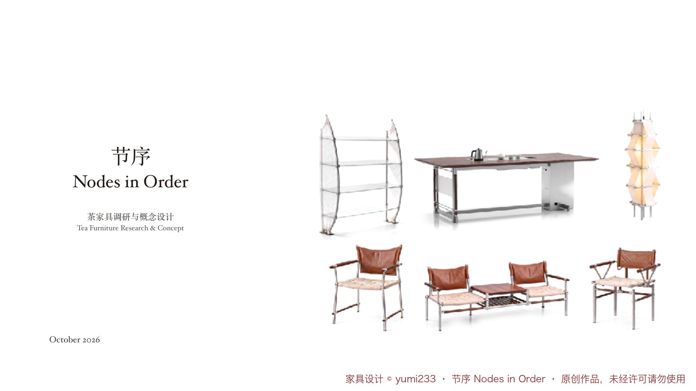
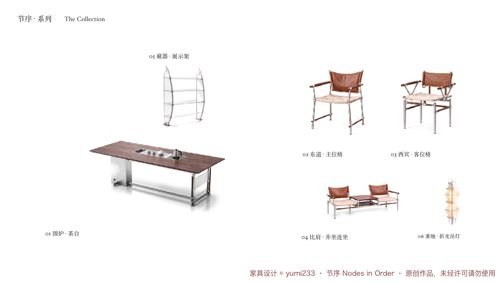
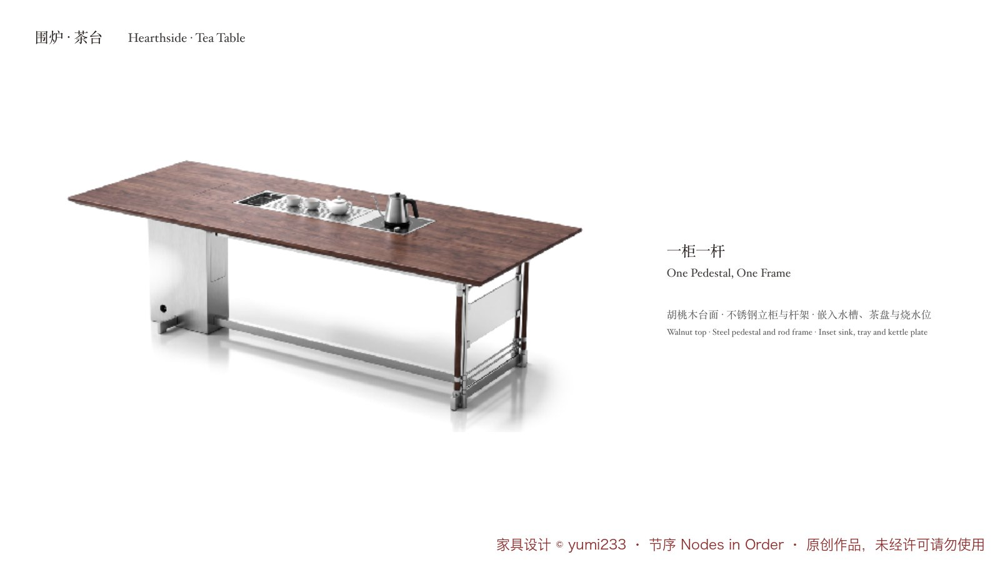
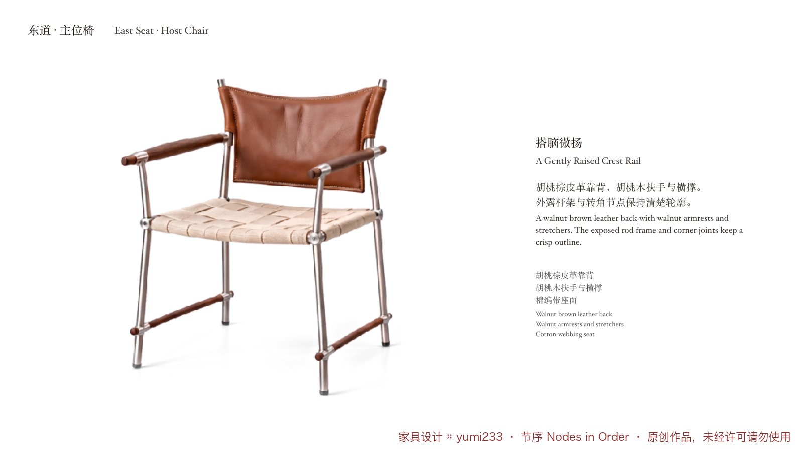

# portfolio-deck-layout

一个 Claude 技能：用「极简东方衬线」版式排任何 PPT（作品集、设计报告、课程汇报、研究报告……），并盘点缺图、给出生图提示词、生成可直接换图的待补图版 PPT。

- 入口：[`SKILL.md`](SKILL.md)
- 规则：[`references/`](references/)（版式、八类项目、页面模板、补图、双语、起名）
- 脚本：[`scripts/`](scripts/)（读稿、抠图、强调色、排版工具、出图）
- 示例：[`examples/`](examples/)

## 安装
把整个目录放到 `~/.claude/skills/portfolio-deck-layout/`。

## 示例效果
以下为示例项目「节序 Nodes in Order」茶家具系列的排版效果。

## 版权说明
- **家具设计**：示例中的六件家具（围炉、东道、西宾、比肩、藏器、秉烛）及其渲染图、草图均为作者 **yumi233 原创设计**，版权归作者所有，未经许可不得使用、复制或用于商业用途。`docs/showcase/` 中的图片均已标注。
- **版式参考**：版式数值实测自一份公开的家具作品集（厝桥 Shelter Bridge），本仓库不包含该作品集的任何图片或内容。
- **调研图片**：示例页面中引用的古画、案例照片版权归原作者 / 收藏机构，仅作示意。
- 代码与文档（`scripts/`、`references/`、`SKILL.md`）可自由使用。
